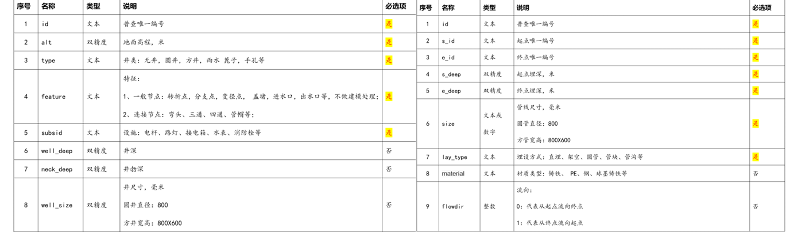
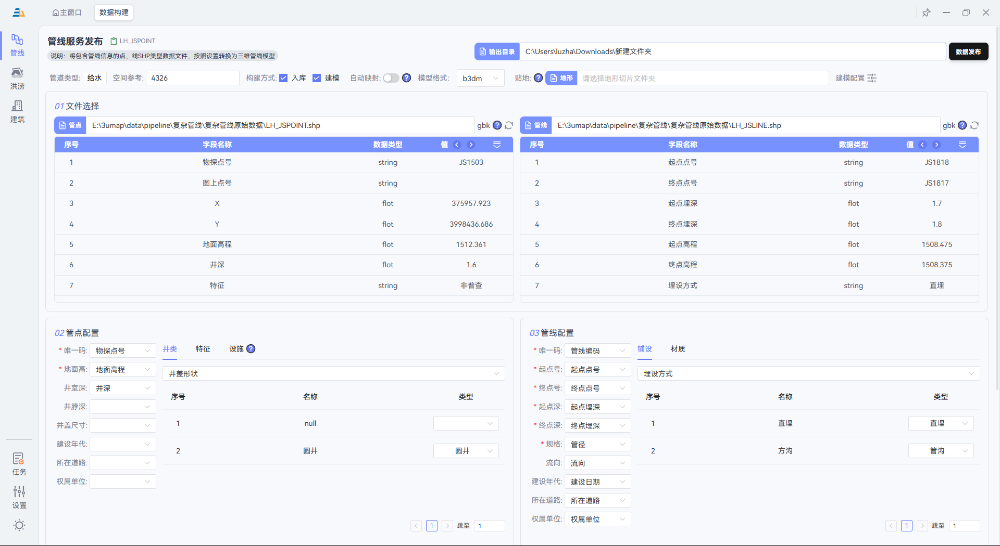
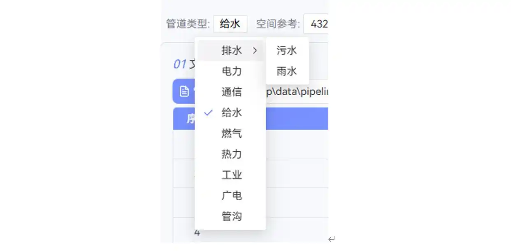
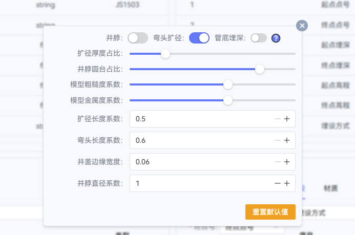
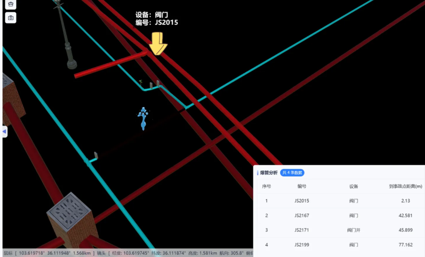

# 3U Map - A Free Desktop Tool for Pipeline Modeling and Flood Simulation, from Parametric Modeling to Application

Keywords: pipeline modeling, parametric pipeline modeling, flood simulation, flood simulation modeling

[中文](./README.md) | [English](./README.en.md)

## 🔥 Pain Point: Why Is 3D Pipeline Modeling So Difficult?

In smart city projects, underground space management, and related fields, 3D pipeline modeling has become a standard requirement. But in reality:

❌ **Traditional 2D management**: Information is flat and cannot intuitively show spatial relationships between pipelines.

❌ **Manual 3D modeling**: It can take months and cost hundreds of thousands.

❌ **Existing parametric tools**: They are complex to operate, limited in pipeline subclasses, restricted in output formats, constrained by data scale, and difficult to learn.

If these problems sound familiar, the tool introduced here may completely change the way you work.

---

## ✨ 3U Map: Making Pipeline Modeling as Simple as Building Blocks

After comparing and testing multiple tools, I finally found a truly **simple, efficient, detailed, and professional** parametric pipeline modeling software: **3U Map**.

It does more than parametric pipeline modeling. Its flood simulation capability is also a major highlight.

### 📊 Prepare Pipeline Data

The software supports standard **Shapefile (SHP)** data, the standard output format in the GIS industry.

**The data requirements are very simple:**

- **Field descriptions for pipeline points and pipeline lines**:

  

  **Comparison between original 2D pipeline data and generated 3D pipelines:**

  
  
  

> 💡 **Tip**: If you are unsure how to map fields, consult the data collection team or refer to the field mapping template we provide.

---

### 🚀 One-Click Parametric Modeling (Core Feature)

This is 3U Map's **killer feature** and the core advantage that sets it apart from other tools:

#### 1️⃣ Intelligent Field Mapping

The software provides a visual field mapping interface. Only simple configuration is required:

*An intuitive field mapping interface with no programming required*

#### 2️⃣ Built-in National Standard Texture Library

The software includes a **built-in pipeline texture library that complies with national standards**:

- ✅ Full coverage of water supply, drainage, gas, heating, power, communications, and more
- ✅ Automatic matching for different materials, such as PVC, cast iron, and steel pipes
- ✅ Colors and textures that strictly follow industry specifications
- ✅ Rich textures for pipeline types and materials

#### 3️⃣ Detailed Modeling Parameters

Modeling details can be adjusted according to project requirements:

#### 4️⃣ Output Models in Multiple Formats

#### ⚡ High-Speed Processing Performance

After completing the configuration, click "Data Publishing" and wait for the result.

**Tested results:**

- Supports batch processing for tens of millions of pipeline records
- Automatically performs data checks and error repair

> 🎯 **Performance comparison**: A project that traditionally takes 2-3 weeks of manual modeling can be completed with 3U Map in just **a few minutes**!

---

### 🎨 Preview and 30+ Practical Functions

Completing the model is only the first step. The real strength of 3U Map is its **30+ built-in professional pipeline application functions**, covering commonly used pipeline workflows.

#### 📸 Instant Preview

After modeling is complete, you can immediately view the 3D result:

*3D pipeline result after parametric modeling: intuitive, realistic, and polished*

#### 🔧 Core Application Functions (Partial Showcase)

**Pipe burst analysis**: Click a pipeline to analyze and display the valves connected to it.

**Built-in query, statistics, analysis, annotation, and more than 30 commonly used pipeline functions**

---

## 🎁 Get It for Free and Try It Now

**Official website**: https://3umap.cn/

✅ **Free to use**: Core features are completely free.

✅ **No registration required**: Download and use immediately.

✅ **Technical support**: Detailed tutorials and one-on-one technical consultation are available.

### 📞 Who Is It For?

- 🏢 Surveying and mapping companies: Quickly deliver 3D pipeline results
- 🏗️ Design institutes: Improve the presentation of design proposals
- 🏛️ Municipal departments: Digitally manage underground spaces
- 🎓 Research institutes: Support smart city research

---

## 💬 Real User Feedback

> "After using 3U Map, our pipeline modeling efficiency improved by 10x, and customer satisfaction increased significantly!"
> - Technical Director, a surveying and mapping company

> "We finally found a pipeline modeling tool that is both professional and easy to use. The whole team picked it up with no difficulty!"
> - GIS Engineer, a design institute

---

## 🚀 Take Action Now

Do not let tedious pipeline modeling slow down your project schedule.

**👉 Visit the official website to download**: https://3umap.cn/

**👉 View tutorials**: Detailed video tutorials are available on the official website.

**👉 Technical consultation**: For any questions, online technical support is available on the official website.

**👉 Contact Email**: luzhansanlvlbb@163.com

**Make pipeline modeling go from a "nightmare" to something enjoyable, starting today!** 🎉

---

*If this article is helpful to you, feel free to share it with more colleagues!*
