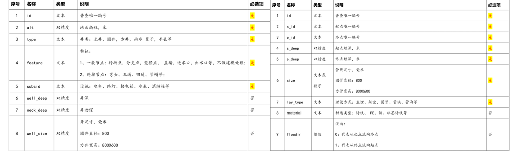
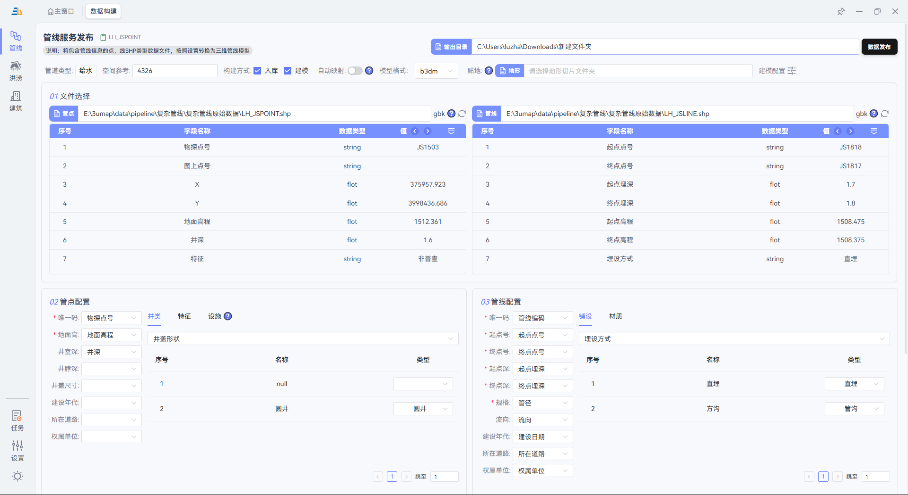
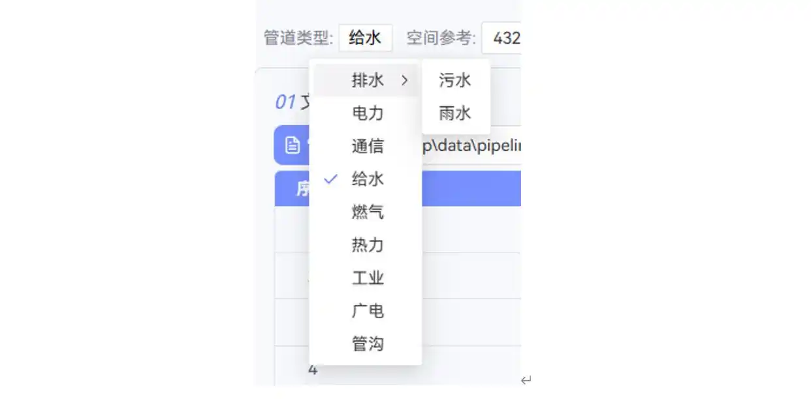
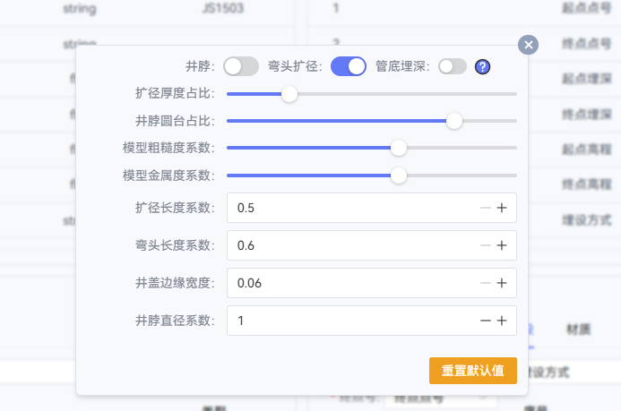
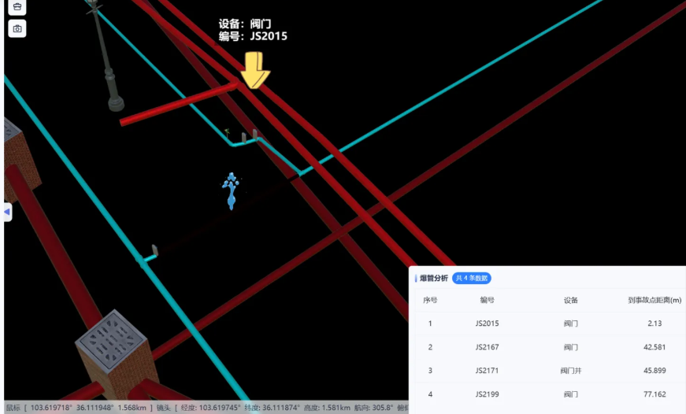

# 三友地图—— 一款免费的管线建模，洪涝模拟工具，从参数化建模到应用的桌面软件

## 🔥 痛点：管线三维建模为何如此艰难？

在智慧城市、地下空间管理等领域，管线三维建模已成为标配。但现实是：

❌ **传统二维管理**：信息扁平，无法直观展示管线空间关系  

❌ **手工三维建模**：耗时数月，成本动辄数十万  

❌ **现有参数化工具**：操作复杂、子类单一、输出格式单一、有数据规模限制、学习成本高

如果你也在为这些问题头疼，那么今天介绍的这款工具，将彻底改变你的工作方式。

---

## ✨ 三友地图：让管线建模像"搭积木"一样简单

经过多款工具对比测试，我终于找到了一款真正**简单、高效、精细、专业**的管线参数化建模软件——**三友地图**。

而且不仅仅支持管线参数化建模，它的洪涝模拟功能也是一大亮点

### 📊 准备管线数据

软件支持标准的 **Shapefile (SHP)** 格式数据，这是GIS行业的标准输出格式。

**数据要求非常简单：**

- **管点、管线字段说明**：

  

  **原始管线数据与生成的三维管线对比：**

  
  
  

> 💡 **小贴士**：如果你不确定字段如何映射，可以咨询数据采集人员，或参考我们提供的字段映射模板。

---

### 🚀 一键参数化建模（核心功能）

这是三友地图的**杀手级功能**，也是区别于其他工具的核心优势：

#### 1️⃣ 智能字段映射
软件提供可视化的字段映射界面，只需简单配置：

*直观的字段映射界面，无需编程基础*

#### 2️⃣ 内置国标贴图库
软件**内置了符合国家标准**的管线贴图库：
- ✅ 给水、排水、燃气、热力、电力、通信等全门类
- ✅ 不同材质（PVC、铸铁、钢管等）自动匹配
- ✅ 颜色、纹理严格遵循行业规范
- ✅ 丰富的管线类型和材质贴图

#### 3️⃣ 精细化建模参数
可以根据项目需求调整建模细节：

#### 4️⃣可输出多种格式模型

#### ⚡ 极速处理性能

配置完成后，点击"数据发布"，坐等结果即可。

**实测数据：**

- 支持千万级管线数据批量处理
- 自动进行数据检查和错误修复

> 🎯 **性能对比**：传统手工建模需要2-3周的项目，用三友地图只需**数分钟**！

---

### 🎨 预览与三十余种实用功能

建模完成只是第一步，三友地图真正强大之处在于**内置的30+种管线专业应用功能**，覆盖管线常用功能模块。

#### 📸 即时预览效果
建模完成后可立即查看三维效果：

*参数化建模后的三维管线效果 - 直观、真实、美观*

#### 🔧 核心应用功能（部分展示）

**爆管分析**：点击管道分析显示与管道相连接的阀门

**内置查询、统计、分析、标注30多种管线常用功能**

---

## 🎁 免费获取，立即体验

**官网地址**：https://3umap.cn/

✅ **免费使用**：基础功能完全免费  

✅ **无需注册**：下载即用  

✅ **技术支持**：提供详细教程和一对一技术咨询  

### 📞 适合人群
- 🏢 测绘单位：快速交付三维管线成果
- 🏗️ 设计院：提升设计方案展示效果
- 🏛️ 市政部门：地下空间数字化管理
- 🎓 科研院所：智慧城市相关研究

---

## 💬 用户真实评价

> "用了三友地图后，我们的管线建模效率提升了10倍，客户满意度也大幅提高！"  
> —— 某测绘公司技术总监

> "终于找到一款既专业又简单的管线建模工具，团队上手零难度！"  
> —— 某设计院GIS工程师

---

## 🚀 立即行动

别再让繁琐的管线建模拖累你的项目进度！

**👉 访问官网下载**：https://3umap.cn/  

**👉 查看教程**：官网提供详细视频教程  

**👉 技术咨询**：有任何问题，官网提供在线技术支持  

**让管线建模从"噩梦"变"享受"，从今天开始！** 🎉

---

*如果这篇文章对你有帮助，欢迎分享给更多同行！*